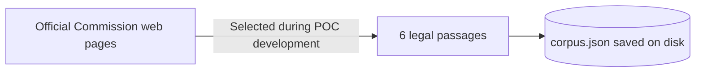
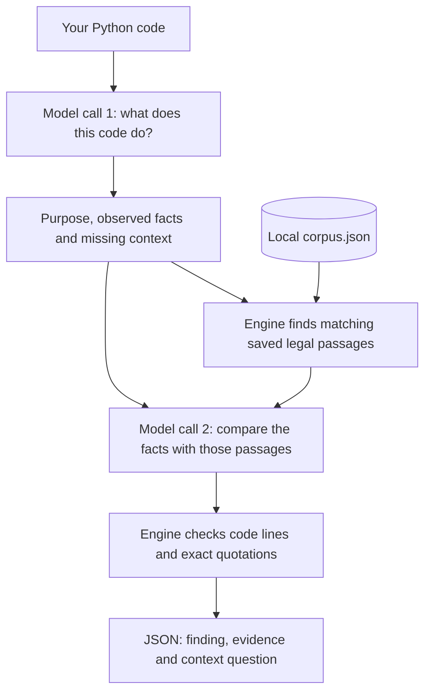

# AI Act Copilot


*by Evros Labs*

AI Act Copilot reads selected Python code, compares its intended use with saved
AI Act passages, and returns code evidence, a legal quotation and a question
about missing context. It helps engineering review; it does not certify compliance.

## What legal text do we use?

The original English AI Act published in July 2024 is **144 pages**, including
its recitals and annexes ([official PDF](https://eur-lex.europa.eu/eli/reg/2024/1689/oj/eng/pdf)).
That page count describes the original publication, not later consolidated versions.
Our POC stores **six selected passages, 526 words in total**, roughly one page.
They were selected during POC development from the Commission's reproductions
of Annex III, Article 6 and Article 50, then checked against those source pages.
There has been no independent legal review of this selection.

We chose passages relevant to the recruitment, biometric and chatbot examples
so we could build and inspect a small end-to-end demo. This was a scope choice,
not a storage limit: saving the full law on disk is feasible. Wider coverage
would require importing the remaining provisions and checking how we select
and interpret them. The current tool cannot review provisions it does not have.



“Corpus” just means **the legal text file the tool can search**. Our
[`corpus.json`](engine/src/aiact/data/corpus.json) contains those six passages,
their source links and verification details. It ships with the Python engine.
During a scan, the file is read into memory. No legal website or API is called.

## What happens when you scan code?



Both model calls use **Ollama**, the program running the model on your machine.
For example, the first call may identify that code ranks job applicants. The
engine then uses keyword matching to select the saved recruitment passage.
The second call gets the code evidence, extracted facts and that passage to
produce a review. The model does not search the web or read the whole law.

Questions are partly templates in
[`pipeline.py`](engine/src/aiact/pipeline.py). For recruitment, it can ask whether
scores affect real hiring decisions. Matching a topic selects the question
options; the model chooses among them in the initial review. This makes the
POC more predictable, but its five examples do not prove that it generalizes to
unseen code or topics. Exact quotation checks also do not prove legal relevance.

## What does update do?

**It runs only when someone explicitly executes `aiact update`.** It does not
run on startup, on save or during a scan. There is no automatic schedule.

It downloads the same three official pages and asks: “Are our six saved passages
still there?” If yes, it saves a verified copy to `~/.cache/aiact/corpus.json`.
Subsequent scans use that cache instead of the packaged copy unless an explicit
corpus path is configured. If a passage changed or a download fails, it keeps
the previous cache and reports an error.

The command currently **rechecks existing text**. It does not import new
articles or update changed legal wording. That needs a reviewed corpus revision.

## Run a review

Install [uv](https://docs.astral.sh/uv/getting-started/installation/) and
[Ollama](https://ollama.com/download), and start Ollama. From the repository root:

```sh
ollama pull qwen2.5:3b
uv run --project engine --python 3.12 aiact scan examples/recruitment/ranker.py --json
```

Download the model once. `uv run` prepares Python, installs the engine and its
dependencies in `engine/.venv`, then runs the scan. No environment activation
is needed. For a setup check, run `uv run --project engine aiact doctor`.

`scan --json` returns `complete`, `partial` or `failed` status, findings,
coverage, errors and model/corpus provenance. Exit code 0 means the review
completed, 1 means it was incomplete or failed, and 2 means a usage or
configuration error. Zero findings does not mean compliant.

The POC currently supports bounded Python source and selected recruitment,
biometric, classification and transparency passages. See the
[extension guide](extensions/vscode/README.md) and
[release notes](docs/releases/v0.1.6-poc.3.md) for usage and limitations.

## Install the VS Code extension

First complete the CLI setup above. Then:

1. Download `ai-act-copilot-0.1.6.vsix` from the
   [POC release](https://github.com/for-aiur/ai-act-copilot/releases/tag/v0.1.6-poc.3).
2. In VS Code, open **Extensions → … → Install from VSIX**, select the file and
   run **Developer: Reload Window** if VS Code is already open.
3. Open this repository root, trust it, open a Python file and run
   **AI Act Copilot: Review current Python file** from the Command Palette.

The checked-in workspace settings point to `engine/.venv/bin/aiact`, created by
uv. The robot icon opens Local setup. If installed Ollama is stopped, use
**Start local service**. The extension uses the same CLI and JSON results.

## CI

[GitHub Actions](https://github.com/for-aiur/ai-act-copilot/actions) runs engine
and extension tests, builds wheel/VSIX packages and uploads release candidates
on pushes and pull requests. See [CI details](docs/CI.md).
