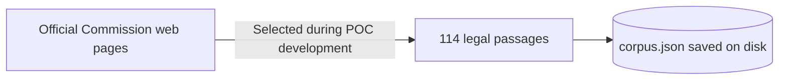
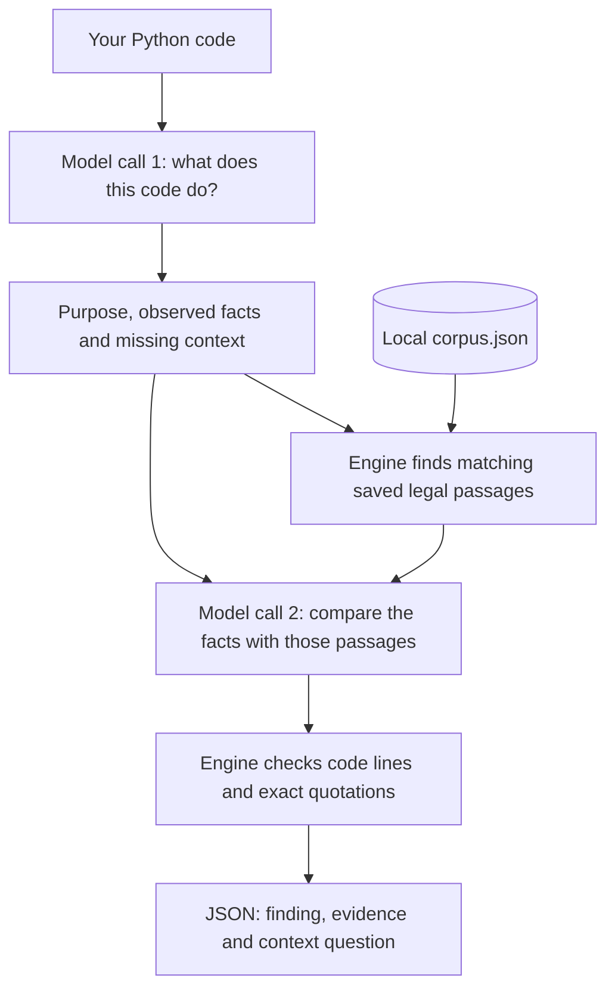

# AI Act Copilot


*by Evros Labs*

AI Act Copilot reads selected Python code, compares its intended use with saved
AI Act passages, and returns code evidence, legal quotations and questions
about missing context. It helps engineering review; it does not certify compliance.

## What legal text do we use?

The original English AI Act published in July 2024 is **144 pages**, including
its recitals and annexes ([official PDF](https://eur-lex.europa.eu/eli/reg/2024/1689/oj/eng/pdf)).
That page count describes the original publication, not later consolidated versions.
The engine stores **114 passages, 8,296 words**, from 15 official Commission
pages: Articles 4a, 6, 8–16, 26 and 50, and Annexes III–IV. Source links and
checksums are saved locally. These are selected provisions, not full coverage or
an independent legal review. Stored coverage exceeds the evaluated use cases.



“Corpus” just means **the legal text file the tool can search**. Our
[`corpus.json`](engine/src/aiact/data/corpus.json) contains the selected passages,
their source links and verification details. It ships with the Python engine.
During a scan, the file is read into memory. No legal website is called; inference uses the selected provider.

## What happens when you scan code?



Both calls use your selected provider: **Ollama** runs the model locally;
**Gemini** sends the selected code/context and retrieved passages to Google.
For example, the first call may identify that code ranks job applicants. The
engine then uses keyword matching to select the saved recruitment passage.
The second call gets the code evidence, extracted facts and that passage to
produce up to four distinct review topics, each with its own evidence and question. The model does not search the web or read the whole law.

Question options live in
[`questions.json`](engine/src/aiact/data/questions.json), separately from code.
There are **164 authored questions**, including an evidence-oriented question
for every stored passage. They ask for dataset lineage, experiment comparisons,
subgroup tests, intervention records and other concrete evidence. The engine
offers a bounded subset for the retrieved passages, with applicability hints;
seven institutional passages have maintenance-only questions, excluded from
developer scans. More questions do not establish broader tested domain coverage.
See the [question catalogue](docs/QUESTION-CATALOG.md) and
[selection rules](docs/QUESTIONS.md). Titles and explanations come from the model;
source lines, bank membership and citation matching are checked independently.

## What does update do?

**It runs only when someone explicitly executes `aiact update`.** It does not
run on startup, on save or during a scan. There is no automatic schedule.

It downloads the same 15 official pages and asks: “Are our saved passages
still there?” If yes, it saves a verified copy to `~/.cache/aiact/corpus.json`.
Subsequent scans use that cache instead of the packaged copy unless an explicit
corpus path is configured. If a passage changed or a download fails, it keeps
the previous cache and reports an error.

The command currently **rechecks existing text**. It does not import new
articles or update changed legal wording. That needs a reviewed corpus revision.

## Run a review

Install [uv](https://docs.astral.sh/uv/getting-started/installation/).
Choose one provider; `uv run` prepares Python and dependencies automatically.
No environment activation is needed.

**Gemini (cloud):** create an [API key](https://aistudio.google.com/apikey), put it
in your shell's `GEMINI_API_KEY` environment variable, then run:

```sh
uv run --project engine --python 3.12 aiact scan examples/recruitment/ranker.py --provider gemini --json
```

The default is `gemini-3.1-flash-lite`. Override with `--model` or, in VS Code,
`aiact.geminiModel`. Selected source, explicit context and retrieved legal text go
to Google using your API quota. Ollama is not needed. See [Gemini setup](docs/GEMINI.md).

**Ollama (local):**

Install [Ollama](https://ollama.com/download) and start it. From the repository root:

```sh
ollama pull qwen2.5:1.5b
uv run --project engine --python 3.12 aiact scan examples/recruitment/ranker.py --model qwen2.5:1.5b --json
```

Download the model once. The engine environment lives in `engine/.venv`.
For a local setup check, run `uv run --project engine aiact doctor --model qwen2.5:1.5b`.

`scan --json` returns `complete`, `partial` or `failed` status, findings,
coverage, errors and model/corpus provenance. Exit code 0 means the review
completed, 1 means it was incomplete or failed, and 2 means a usage or
configuration error. Zero findings does not mean compliant.

The POC currently supports bounded Python source and selected recruitment,
biometric, classification and transparency passages. See the
[extension guide](extensions/vscode/README.md) and
[release notes](docs/releases/v0.1.6-poc.4.md) for usage and limitations.
Published changes are listed in the [changelog](CHANGELOG.md).

## Choose a model

This repository's workspace selects `qwen2.5:1.5b` for a smaller local model.
For Ollama, in VS Code Settings, search `aiact.model` and choose Workspace, or edit:

```json
{
  "aiact.model": "qwen2.5:1.5b"
}
```

The model must already be installed in Ollama. CLI users select it with
`--model qwen2.5:1.5b` or the `AIACT_MODEL` environment variable. Changing the
setting does not download a model. Review results identify the model used.

## Install the VS Code extension

Prepare the engine once with `uv run --project engine aiact --version`. Then:

1. For the Gemini preview, build from this checkout with
   `npm --prefix extensions/vscode ci` and `npm --prefix extensions/vscode run package`.
   The [published POC](https://github.com/for-aiur/ai-act-copilot/releases/tag/v0.1.6-poc.4)
   is an older Ollama-only snapshot.
2. In VS Code, open **Extensions → … → Install from VSIX**, select
   `extensions/vscode/ai-act-copilot-0.3.0.vsix`, then **Developer: Reload Window**.
3. Open the repository root and trust it. For Gemini, run
   **AI Act Copilot: Configure Gemini**, enter your key in the masked field and
   approve cloud review for this workspace. The key goes into VS Code's secure
   storage, never settings JSON.
4. Open a Python file and run **AI Act Copilot: Review current Python file**.

The checked-in workspace settings point to `engine/.venv/bin/aiact`, created by
uv. The robot icon opens Provider setup with engine, provider, model and corpus
health. For local Ollama, choose `aiact.provider: ollama` and use **Start local
service** if needed. Both providers use the same review pipeline and report.

## CI

[GitHub Actions](https://github.com/for-aiur/ai-act-copilot/actions) runs engine
and extension tests, builds wheel/VSIX packages and uploads release candidates
on pushes and pull requests. See [CI details](docs/CI.md).

## Multi-topic examples

Review `examples/recruitment/training_review.py` for training/data governance,
parameter choices, oversight and evaluation. `examples/recruitment/bias_audit.py`
adds a special-category bias-audit retention/deletion scenario. Missing facts
become questions, not proof of unethical training or dirty data. The engine
returns at most four findings and retrieves at most six passages per scan.

The corpus is searched locally with lexical ranking, topic gates and synonyms.
No vector database or embeddings are required. Real Gemini output quality still
needs manual review; fixture tests use test-only providers.

## GitHub PR review

GitHub Actions reviews changed Python files and posts code evidence, official
sources and questions to the PR. No server or persistent database is required.
Configure roles/model in `bot/actions.toml`, add the `GEMINI_API_KEY` Actions
secret, then set the repository variable `AIACT_PR_REVIEW_ENABLED=true`.
This enables sending selected PR code and legal passages to Google.

An authorized reviewer can post `/aiact rescan` in the PR conversation.
Matching bot comments are updated; replies remain in GitHub but are not consumed
by the model. Decision history, automatic resolution and the dashboard are
deferred. Fork PRs are disabled. [Setup and limits](docs/PR-ACTIONS.md).
