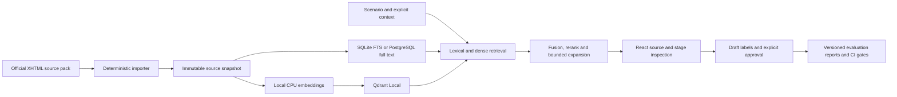

# Local application architecture

The public project page and signed-in customer dashboard are separate from the
internal React + Vite RAG workbench. In Docker, Nginx serves the dashboard and
forwards `/api` requests to one FastAPI process. That process owns the embedded
Qdrant path and the bounded review worker. Evaluation containers call its API
instead of opening its files.

## Modules

- `rag/official.py`: reproducible import of pinned Publications Office XHTML.
- `rag/contracts.py` and `domains.py`: generic document/query/evaluation contracts
  and explicit AI Act / technical reference adapters.
- `settings.py`: central runtime configuration. Environment overrides `.env`;
  explicit caller settings override both. Secrets are redacted.
- `rag/store.py`: immutable snapshots, chunks, source links, releases, pointers,
  case revisions and runs. SQLite is local default; PostgreSQL is explicit.
- `rag/embeddings.py`: local FastEmbed CPU inference. Download is setup-only;
  query-time model loading is cache-only.
- `rag/releases.py`: content-addressed source/vector bundles and manifest checks.
- `rag/retriever.py`: bounded retrieval, explicit reference addressing, fusion,
  deterministic reranking and parent/cross-reference expansion.
- `rag/review.py`: source collection, model purpose extraction, retrieved-source
  review and independent evidence validation. It reuses the existing Provider
  and ScanResult contracts.
- `rag/feedback.py`, `evaluation.py`, `benchmark.py`: revisioned annotations,
  generic metrics and quality policy. Feedback does not mutate ranking.
- `workbench/`: local HTTP adapter, bootstrap and compatibility endpoints.

## Version and privacy boundaries

A RAG manifest includes source/adapter/parser/code identities, actual embedding
file hashes, index fingerprints, rank policy and budgets. Source snapshots retain
exact normalized text and offsets. A different code context is a different
retrieval input. Missing or mixed artifacts fail explicitly.

Publication, entry into force and conditional application rules are separate.
Unknown actor roles/dates remain unknown. Recitals are marked explanatory.
Legal text is imported from official files, never generated by a model.

Source browsing and retrieval need no cloud key. Gemini review sends the selected
source and context only after explicit consent. Langfuse export is separately
opt-in and contains stage metadata, not code/prompts/answers. Explicitly saved
review results retain their evidence in the private local data store.

The local dashboard supports tenant workspaces, review history, context answers,
API keys and usage records. Review jobs pin the active RAG release when they are
created, then resume against that same release after an answer or process restart.
The existing GitHub Actions bot remains a separate adapter.

See [local deployment boundaries](LOCAL-DEPLOYMENT.md) for the current local
stack and a future AWS mapping. No AWS resources are part of this repository's
local setup.
