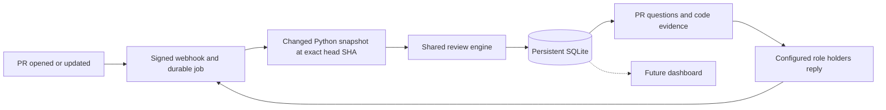

> Deferred deployment option. For the current server-free PR review, use [GitHub Actions](PR-ACTIONS.md).

# GitHub PR bot preview

The GitHub App reviews changed Python files, asks source-grounded questions in
the PR, and records scans, comment revisions and human decisions in persistent
SQLite. It reuses the existing engine. There is no dashboard UI yet.



## Register the App

Create a private GitHub App for the selected repositories. The reference
[manifest](../bot/github-app-manifest.json) lists the settings; replace its
placeholder webhook URL with your HTTPS address ending `/webhooks/github`.
Use our [existing icon](../extensions/vscode/media/copilot-wig-avatar.png) as the App's
avatar. The GitHub App avatar identifies the bot in PRs; no broken private-repo
image URL is embedded in comments.

Required repository permissions:

- **Contents: read** to obtain immutable source snapshots.
- **Pull requests: write** to read PR data and create/update review comments.
- **Issues: read** to receive `issue_comment` events, including PR conversation
  replies. The service ignores ordinary issues.
- Metadata read is implicit. No workflow, administration or repository-write
  permission is requested.

Subscribe to `pull_request`, `issue_comment`, `pull_request_review_comment` and
`pull_request_review`. Signed ping and automatic installation deliveries are acknowledged without scanning. Create a webhook
secret, generate an App private key, and install the App only on approved repos.
These account/credential steps are completed by the operator, not by this code.

References: [webhook validation](https://docs.github.com/en/webhooks/using-webhooks/validating-webhook-deliveries),
[installation tokens](https://docs.github.com/en/apps/creating-github-apps/authenticating-with-a-github-app/generating-an-installation-access-token-for-a-github-app),
[event permissions](https://docs.github.com/en/webhooks/webhook-events-and-payloads#issue_comment).

## Configure and start

Copy `bot/config.example.toml` to `bot/config.toml`. Set the explicit repository
allowlist and GitHub logins for the roles you use:

```toml
[roles]
privacy_officer = ["your-privacy-reviewer"]
model_owner = ["your-model-owner"]
engineering = ["your-engineering-reviewer"]

[routing]
"article-4a" = ["privacy_officer"]
"article-10" = ["privacy_officer", "model_owner"]
"annex-iv-2" = ["model_owner"]
"article-14" = ["engineering"]
```

Role names and routing are editable operator policy. Unassigned roles are shown
as unassigned; the bot does not invent users. Configuration comes from this
operator file, never from the PR being reviewed. Restart after changing it.
Role membership is declared here, not inferred from job titles or org profiles.

For local service execution, set these environment variables through your shell
or secret manager:

- `AIACT_BOT_APP_ID`
- `AIACT_BOT_WEBHOOK_SECRET` (at least 32 characters)
- `AIACT_BOT_PRIVATE_KEY_PATH` (path to the downloaded PEM), **or**
  `AIACT_BOT_PRIVATE_KEY_B64` (one-line base64 of that PEM)
- `GEMINI_API_KEY` for Gemini

Then, from the repository root:

```sh
uv run --project engine --extra bot aiact-bot serve --config bot/config.toml
```

The default listener is `127.0.0.1:8787`. Put an HTTPS reverse proxy in front of
`/webhooks/github` so GitHub can reach it. `/healthz` reports the HTTP listener,
not verified model/API readiness. The default local database is
`.aiact-bot/reviews.sqlite3`; `AIACT_BOT_DATABASE` can override its location.

For the optional single-container deployment, fill the untracked `bot/.env`
from `bot/.env.example`, then run:

```sh
docker compose -f bot/compose.yaml up --build -d
```

The named volume `bot-data` holds `/data/reviews.sqlite3`; it survives container
recreation. Run one replica. Keep this volume and its backups private because
it contains code evidence and reviewer comments. Preserve the database with
SQLite's backup API or a consistent stopped-service backup, including WAL state.
Removing the volume removes history. No automatic retention purge is enabled.

Gemini mode requires `cloud_review = true`. It sends bounded changed source and
accepted reviewer statements to Google. The editor's SecretStorage key is not
extracted or reused; supply a service-specific key. Local Ollama is also
supported by setting provider/model/endpoint appropriately.

## Answer and resolve findings

Each finding has a stable bot ID, review priority, pinned code lines, official
quotation, question, next action and requested roles. It is an inline review
comment when the evidence endpoint is in the PR diff; otherwise it is a PR
conversation comment with an immutable source permalink.

Use a new comment or reply, with the complete command as its body:

```text
/aiact evidence FINDING_ID Link to the evaluation report and explain the result.
/aiact objection FINDING_ID The code is a test fixture; explain the actual scope.
/aiact false-positive FINDING_ID Reason and supporting evidence.
/aiact resolve FINDING_ID What was done and where its evidence is recorded.
/aiact done FINDING_ID Same meaning as resolve.
/aiact reopen FINDING_ID Explain why further review is needed.
/aiact rescan
```

Replace `FINDING_ID` with the 20-character ID in the comment.

| Input | Result |
| --- | --- |
| Ordinary comment/reply | Archived; not silently treated as approved model context |
| Evidence | Archived as explicit reviewer input and triggers a bounded rescan |
| Objection | `disputed`, with actor, roles and reason retained |
| False positive | `false_positive`, scoped to evidence and review policy |
| Resolve/done | Human `resolved` decision; not a compliance determination |
| Reopen | `needs_context` |
| Rescan | New review at current PR head |

Repository writers or configured role holders can provide evidence/objections
and request a rescan. A matching requested role holder or repository maintainer/
admin can dismiss, resolve or reopen a finding. Other comments are retained but
do not change decisions. Edited/deleted commands do not silently undo historical
decisions; submit a new command. Renamed files have a new tracking identity in this preview. Native GitHub thread resolution is separate:
use the bot command to change the tracked finding state in this preview.

Human statements are labelled unverified in model context. Evidence links are
stored as text, not fetched automatically. Only a bounded recent subset enters
the model; the database retains the full captured history.

## Rescans and history

- Identity uses repository, PR, file, containing symbol, question topic and legal
  sections, so shifting line numbers does not create a new finding by itself.
- Human decisions carry over only while their code evidence and review policy
  match. Changes to evidence/model/corpus/question bank/role policy reopen them.
- A finding absent from a later **complete** scan of its file becomes resolved
  with a distinct `scan_not_raised` event. Failed/partial scans do not close it.
- Reintroducing an automatically resolved finding reopens it. Deleted or no-longer
  changed files are excluded, not silently declared fixed in this initial slice.
- Old PR heads are rejected before publication. A durable run checkpoint and
  marker reconciliation recover from retries without deliberately reposting
  duplicate comments or repeating a completed model run.
- Existing comments are backfilled when first scanning a PR. Subsequent created,
  edited and deleted comment/review webhooks append revisions with timestamps,
  authors and event actors. Edits that happened before installation cannot be
  reconstructed from GitHub's current snapshot.

Bot comments are updated in place. An original inline anchor may become outdated
after a push; its body links to the latest observed pinned range. The database
keeps the old versions rather than overwriting the conversation history.

## Inspect data for the later dashboard

```sh
uv run --project engine --extra bot aiact-bot export \
  --database .aiact-bot/reviews.sqlite3 --repo for-aiur/ai-act-copilot --pr 123
```

The JSON contains priority-ordered `dashboard_findings`, run records, chronological
comment revisions, finding history and job status/errors. Priority is the engine's
engineering-review priority (`high`, `medium`, `low`), not a legal risk class.
No unauthenticated network endpoint exposes these records. A later dashboard can
consume this schema through an authenticated service.

## Current bounds and verification

Each run selects at most 10 changed visible Python files and 24 KB source plus
review context, with six passages, four findings and the shared 120-second scan
budget. The bot reads trusted-base ignore rules and rejects symlink/nonregular
blobs. It never checks out, imports, builds or executes PR code. Fork scanning
is disabled unless the operator explicitly enables it.

Webhook bodies are limited to 1 MB. GitHub calls are bounded/paginated (200 requests and a five-minute client deadline per job attempt); deliveries have at most three processing
attempts. A completed run is reused on duplicate delivery. A crash during an
unfinished model request may still repeat that request on restart. The service
is one worker and one SQLite database, not a horizontally scaled production
platform. Dashboard UI, SSO, native thread-state syncing and additional model
providers are not included.

Local integration tests exercise the real engine, signature validation, HTTP
handler, SQLite persistence, feedback and reconciliation with test-only GitHub
and model adapters. Actual App installation, public HTTPS delivery and live
Gemini PR review require operator credentials and remain separate acceptance
checks; passing those local tests does not claim that live deployment passed.
