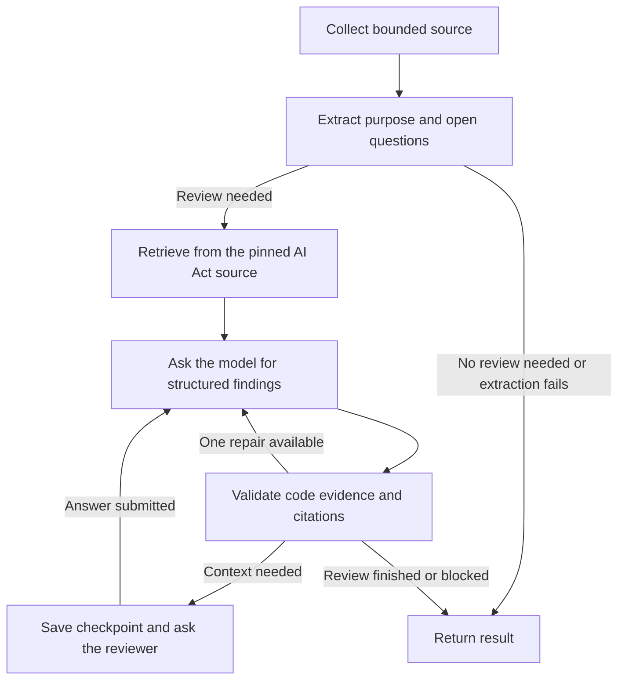

# AI Act Copilot review agent

The saved review agent uses **LangGraph** to coordinate a code review and pause
when a reviewer needs to supply context. LangGraph provides the graph, state,
checkpoints and resume mechanism. The application's Python code implements
retrieval, provider calls, evidence validation and review decisions.

## Review flow

1. **Collect source.** The agent reads the bounded input and records evidence
   locations. It does not execute the code.
2. **Extract purpose.** The model identifies what the code appears to do,
   supported facts and open questions. The agent builds retrieval queries from
   that context.
3. **Retrieve sources.** The configured RAG release searches pinned legal
   passages. Retrieval and embedding run locally.
4. **Review and validate.** The provider returns structured findings. The
   application validates code ranges, quotations and citation identifiers
   against the evidence supplied to the model. An invalid result can use one
   repair attempt within the review budget.

The model provider comes from local settings. Gemini requires explicit consent
to send the selected source, scenario context and retrieved passages. Ollama
is available when configured. See [Gemini setup](../GEMINI.md).

## Human review and checkpoints

In **Code Checks**, a saved job can enter **Context Needed** with a question tied to
a finding. The agent pauses at a LangGraph interrupt. An answer resumes the
same checkpoint and returns to legal review using the pinned source and
retrieved passages. A separate **Rescan** starts a new job with the active source.

SQLite stores the local checkpoints by default. The review worker also keeps
the bounded job input so a queued job can recover after a restart. See
[Saved review sessions](../REVIEW-SESSIONS.md) and the
[review API](../LOCAL-WORKSPACES.md#review-jobs).

## Entry points

| Entry point | Behavior |
| --- | --- |
| **Dashboard Code Checks** | Queues a saved review and supports context questions and resume. |
| **Website sample** | Runs a bounded review and returns findings directly to the page. |
| **CLI and editor** | Use the engine review pipeline through the existing scan interface. See the [VS Code guide](../../extensions/vscode/README.md). |

The saved graph is in [`rag/sessions.py`](../../engine/src/aiact/rag/sessions.py).
The [review worker](../../engine/src/aiact/workbench/reviews.py) runs the graph
and manages jobs. The website preview uses the separate
[full source review function](../../engine/src/aiact/rag/review.py).
